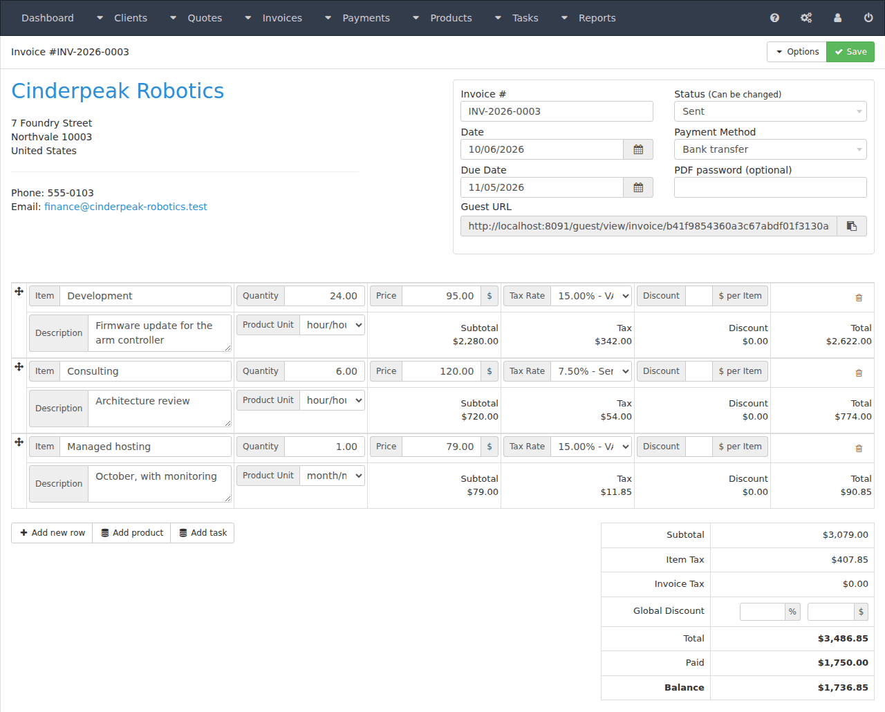
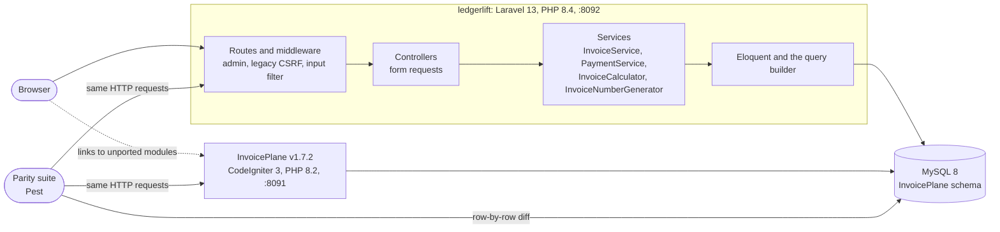
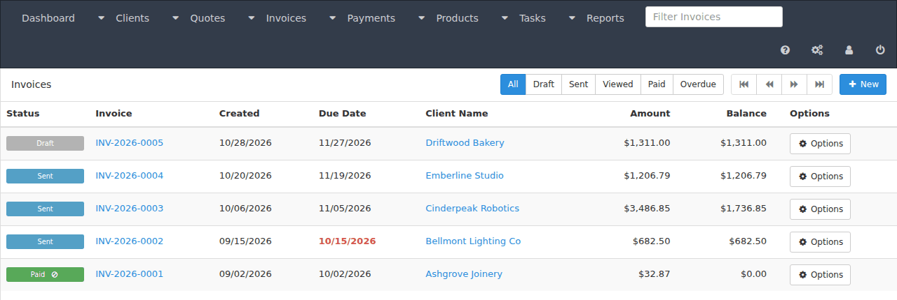
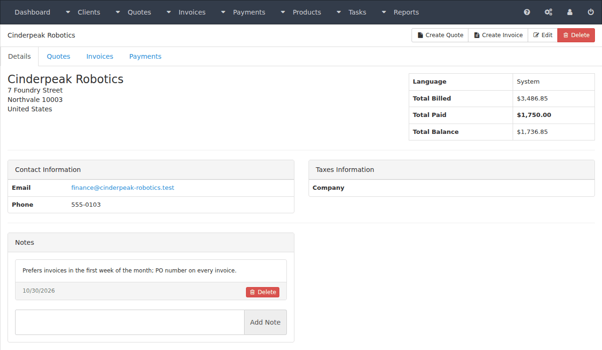

# ledgerlift

InvoicePlane's money path, migrated from CodeIgniter 3 to Laravel 13 on the same MySQL database,
with a parity suite that proves both apps behave the same.

[](https://github.com/rasarafi/ledgerlift/actions/workflows/ci.yml)
[](LICENSE)



## What this is

[InvoicePlane](https://github.com/InvoicePlane/InvoicePlane) v1.7.2 is an open-source invoicing
app written in CodeIgniter 3. ledgerlift rewrites its core modules in Laravel 13 (PHP 8.4):
Eloquent models, service classes for the business rules, form requests, middleware, Blade views.
It runs on InvoicePlane's existing database, unchanged, and shows the same screens.

Every migrated behaviour is checked against the real thing. The parity suite runs each scenario
against an unmodified InvoicePlane v1.7.2 and against ledgerlift, over HTTP, then compares the
responses and both databases row by row. Any difference fails the build, unless it is
deliberate and documented.

InvoicePlane's own team is building v2 in Laravel with a new schema and Filament. ledgerlift is a
different exercise: keep the database and the screens, and prove that the behaviour is unchanged.

## Why the same database

The usual constraint on a legacy migration is a live database full of company data that cannot
be redesigned on day one. So ledgerlift does not get its own schema:

- The Laravel migrations reproduce all 42 InvoicePlane tables exactly: engine, collation,
  columns, indexes and AUTO_INCREMENT. The Schema suite runs them on an empty database and
  compares the result with a fresh InvoicePlane install, including the rows the installer seeds.
  The only table ledgerlift adds is Laravel's own `migrations`.
- Existing users log in with their existing passwords. Invoice PDF passwords are encrypted with
  the legacy install's key, so each app reads what the other wrote.
- The two apps can run side by side on the same data. Navbar links to modules that are not
  ported yet go to the legacy app, so the migration can proceed one module at a time.

## Status

| Module | State |
|---|---|
| Login, logout, login throttling | Migrated |
| Dashboard (invoice overview, overdue, recent invoices) | Migrated |
| Clients, client notes, the client view and its tabs | Migrated |
| Products, families, units, the product lookup | Migrated |
| Tax rates, payment methods, invoice groups (numbering) | Migrated |
| Invoices: items, item and invoice taxes, discounts, rounding, statuses, numbering | Migrated |
| Payments: partial payments, balances, the add-payment modal | Migrated |
| Quotes and quote to invoice | Next |
| Recurring invoices (queued job and scheduled command) | Next |
| Invoice and quote PDFs | Next |
| Emailing an invoice | Next |
| REST API (`/api/v1`, Sanctum) | Next |
| Guest portal, custom fields, email templates, reports, import, projects and tasks, uploads, user-client mapping, setup wizard | Later |

## How parity is proven

1. `docker compose` starts InvoicePlane v1.7.2, built from its upstream tag, and ledgerlift, each
   with its own database on one MySQL 8 server.
2. Before each scenario both databases are restored to the same baseline: a fresh InvoicePlane
   install plus a small fixture company (made-up names and addresses).
3. The scenario drives both apps through the same HTTP requests the browser sends: forms, AJAX
   endpoints, redirects and CSRF tokens included.
4. Pages are compared on what a user sees (titles, flashes, tables, totals, form values); JSON is
   compared as returned.
5. Every `ip_*` table of both databases is then diffed row by row, money columns included.

Timestamps and random tokens are masked (`tests/Parity/normalise.php`, six columns, each with
the legacy line that produces it). The harness checks itself: one test injects a difference and
expects a failure, another runs legacy twice and expects only the masked columns to differ.

| Area | Parity tests |
|---|---:|
| Login and logout | 3 |
| Tax rates, families, units, payment methods, invoice groups | 24 |
| Products and the product lookup | 19 |
| Clients, notes and the client view | 17 |
| Invoices: create, save, items, taxes, discounts, numbering, read-only, deletes, lists | 15 |
| Invoice calculator on seeded invoices | 5 |
| Payments: modal, form, list, overpayment, deletes, European separators | 9 |
| Dashboard and list filters | 3 |
| Harness self-checks | 3 |
| **Total** | **98** |

Many scenarios run under several settings (number and date formats, currency placement, page
sizes, numbering options).

### Deliberate differences

Database differences that are allowed are listed in `tests/Parity/intentional-differences.php`,
one column at a time with a reason. There is one:

| Column | Why it differs |
|---|---|
| `ip_invoices.invoice_password` | Legacy draws a random IV for every encryption, so the same password never encrypts to the same text twice, on legacy either. The diff decrypts both sides and requires the same password. |

Everything else that differs is outside the database and listed, with the legacy file and line,
in [`tests/Parity/known-differences.md`](tests/Parity/known-differences.md). The ones that
matter:

- **Deletes work.** Legacy's delete is broken (see below); ledgerlift deletes.
- **Ids in URLs must be numeric.** Legacy lets MySQL coerce `invoices/view/1-alert(1)` to
  invoice 1 and prints the raw segment into the page's scripts, a reflected XSS. ledgerlift
  answers 404 for any non-numeric id, offset or page.
- **Output is escaped** where legacy echoed request input raw (the invoice group form, the
  add-payment modal, unknown client countries).
- **Redirects to the referring page** go through a same-origin check (a port of legacy's
  `get_safe_referer()`).
- **Sessions and CSRF** use Laravel's per-session token instead of legacy's fixed cookie; the
  apps do not share sessions.
- **Unported actions** (quotes, PDF download, copy invoice, credit note and others) are plain
  links to the same screen in the legacy app.

## What the parity tests found

**InvoicePlane v1.7.2 cannot delete anything.** In every module (tax rates, families, units,
payment methods, invoice groups, products, clients, invoices, invoice taxes, payments), a delete
POST with a valid CSRF token is refused and the row stays. CodeIgniter's global CSRF check
verifies the token and removes `_ip_csrf` from `$_POST`; the controller's
`ensure_valid_post_request()` then verifies it a second time, finds nothing and refuses with
`invalid_request`. This was reproduced against the running legacy app.

ledgerlift deletes, as the legacy model code was written to. Since legacy refuses over HTTP,
delete parity is proven at the model level: the scenario records both apps' answers, then
applies legacy's own delete semantics (`Mdl_*::delete()`, `delete_orphans()`, and legacy's own
recalculation where it has one) to the legacy database, and diffs the two end states. Those
scenarios say "model-level" in their names.

**PHP 8.2 and PHP 8.4 round money differently.** Legacy runs on PHP 8.2, whose `round()`
pre-rounds to 15 significant digits; PHP 8.4 dropped that step. A sweep of 200,000
discount-style values (`total / 100 × percent`, at 2 and 3 decimal places) found 104 values,
about 0.05%, where the two versions disagree, for `round()` and for `number_format()` alike.

A concrete invoice: one item of 2,150.00 with a 43.87% discount. The discount is
2150 / 100 × 43.87 = 943.20499999999993. PHP 8.2 rounds it to 943.21 and legacy stores a total
of **1,206.79**; plain PHP 8.4 gives 943.20 and a total of 1,206.80. ledgerlift's `LegacyMath`
pre-rounds to 15 significant digits the way PHP 8.2 did and matched it on all 200,000 values.
This invoice is pinned in both the calculator tests and the parity suite.

The money maths is ported in legacy's exact order of operations, and MySQL's `DECIMAL` columns
do the rounding on write, as they do for legacy.

## Architecture at a glance



Controllers stay thin; the money rules live in injected services. `InvoiceCalculator` ports
`Mdl_invoice_amounts` and `InvoiceNumberGenerator` ports invoice group numbering. Legacy quirks
are kept where they are behaviour, and each one cites the legacy file and line it reproduces.





## Run it

You need Docker, PHP 8.4 with Composer, and the ports 3317, 8091 and 8092 free.

```bash
docker compose up -d --build --wait   # MySQL :3317, InvoicePlane :8091, ledgerlift :8092
composer install
cp .env.example .env && php artisan key:generate
```

The first build fetches InvoicePlane v1.7.2 from GitHub. Legacy installs itself on first start;
`--wait` returns once both apps answer.

| | URL |
|---|---|
| InvoicePlane v1.7.2 | http://localhost:8091 |
| ledgerlift | http://localhost:8092 |

Demo login on both: `admin@ledgerlift.test` / `ledgerlift-demo-1`.

ledgerlift's database starts empty. The parity suite fills it: each scenario restores both
databases to the fresh install plus the fixture company, so after `composer parity` both apps
can be browsed on the same data.

```bash
composer schema   # the Laravel migrations against a fresh InvoicePlane install
composer parity   # every parity scenario against both running apps
composer test     # Unit and Feature tests (Pest)
```

Run `composer schema` before anything logs into legacy: it takes the legacy database, as the
installer left it, as the pristine reference. CI runs Pint, Larastan, all three suites, and
posts a summary of the parity run.

`docker compose down -v` resets everything. The databases are created by
`docker/mysql-init.sql`, which MySQL runs only on an empty volume, so after changing it run
`down -v` first.

MySQL 8 runs with a relaxed `sql_mode` (no `NO_ZERO_DATE`): InvoicePlane's installer writes
`'0000-00-00'` dates, which MySQL 8's default mode rejects. Upstream targets MariaDB, whose
default mode allows them. Both apps share the server and the mode.

Last local run: 418 Unit and Feature tests (1,703 assertions), 6 Schema tests (150 assertions),
98 parity tests (763 assertions), all passing.

## Known legacy behaviours kept on purpose

These look like bugs, but they are what v1.7.2 does, so ledgerlift does the same and the parity
suite proves it:

- **Zero and negative payments are accepted.** Legacy only rejects an amount above the balance.
  A negative payment raises the balance; a zero payment on a zero-total invoice marks it paid,
  straight from draft.
- **The discount percent is cast before it is standardised.** `(float) "10,5"` is 10, so a
  percent typed with a decimal comma loses its fraction, even under European number settings.
- **A combined discount keeps only the percent.** An invoice saved with both an amount and a
  percent has its amount zeroed.
- **A payment can be moved to another invoice** by editing it; the posted invoice is the one
  validated and recalculated.
- **Deleting a payment keeps `is_read_only`.** A paid invoice goes back to sent but stays
  read-only.
- **"Last month" and "last quarter" on the dashboard** compare with the current year, so in
  January (or the first quarter) they find nothing.

## Credits

ledgerlift is derived from [InvoicePlane](https://github.com/InvoicePlane/InvoicePlane)
v1.7.2, which is MIT licensed. InvoicePlane's built CSS and JavaScript (`public/assets/`), its
English strings (`lang/en/ip.php`) and the markup of the ported views come from it; see
[`public/assets/THIRD-PARTY.md`](public/assets/THIRD-PARTY.md).

ledgerlift is not affiliated with or endorsed by InvoicePlane. The InvoicePlane name and logo
belong to their owners and are used here only to name the application this project migrates.

InvoicePlane is built on CodeIgniter. ledgerlift is derived from software that is derived from
CodeIgniter, and acknowledges it as its licence requires.

## Licence

MIT, see [LICENSE](LICENSE). The InvoicePlane-derived files remain under InvoicePlane's licence,
reproduced in [`public/assets/LICENSE-InvoicePlane.txt`](public/assets/LICENSE-InvoicePlane.txt).
